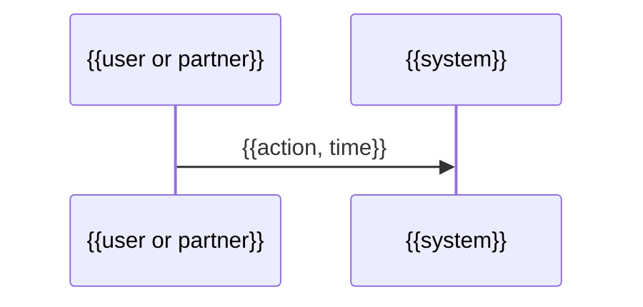

# Flows: {{KEY or name}}

Diagrams use the words of the product: steps, decisions, statuses. No class names.

## How it works now

```mermaid
flowchart TD
  A[{{user action or incoming request}}] --> B{{{decision}}}
```

Walk-through:

1. {{step in plain words: what the system checks or does, what the user sees}}

## How it should work

```mermaid
flowchart TD
  A[{{user action or incoming request}}] --> B[{{expected step}}]
```

Where it differs from now: {{list; mark the differing steps, with R-ids}}

## Timeline of the case (investigation only)



## Statuses (optional)

{{status diagram or "not applicable"}}
