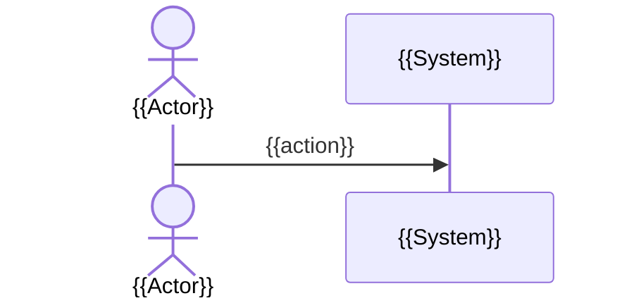

# {{process name}}

> Part of [{{domain title}}](../README.md). {{when it happens and who starts it, one line}}

## Summary

{{3-5 lines: the outcome, the rule that matters most, what the user sees at the end}}

## Diagram

## Steps

1. {{step in business language; the rule it applies (BR*)}} (`{{repo/path/File.java:120}}`)

## Rules applied

| Rule | In short |
| --- | --- |
| [BR{{n}}](../reference/rules.md#br{{n}}) | {{one line}} |

## Alternative and error paths

### {{name}}

{{when it happens, what the user sees, what the system stores}} (`{{repo/path/File.java:120}}`)

## Edge cases

- {{non-obvious behaviour: rounding, time zones, retries, partial failures, legacy branches}} (`{{repo/path/File.java:120}}`)

## What to test

| Case | Test data that triggers it | Expected result | Where it is visible |
| --- | --- | --- | --- |
| {{case}} | {{data}} | {{result}} | {{screen / table / log / event / email}} |
